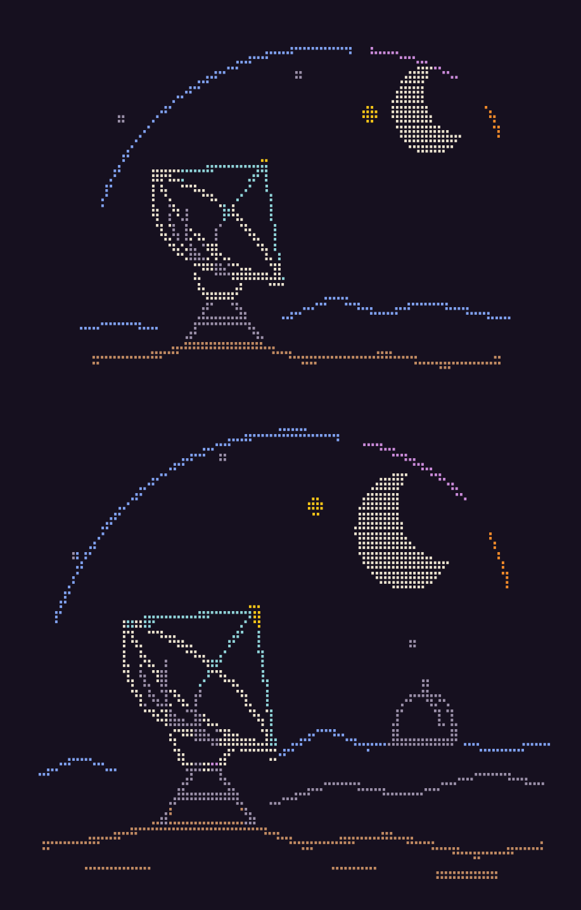
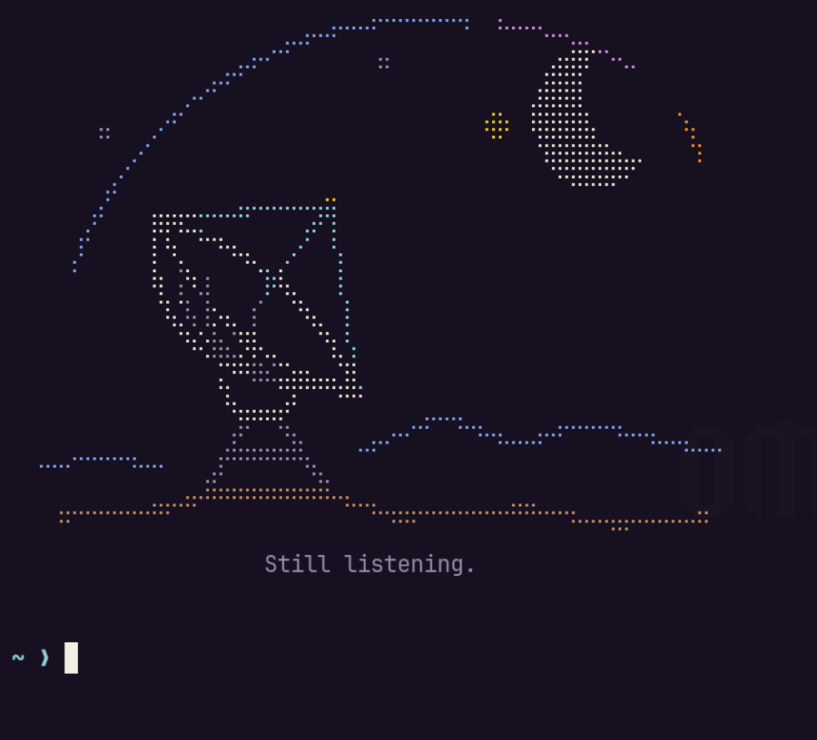
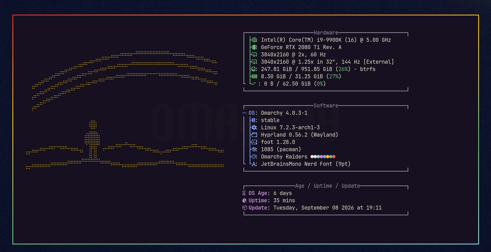
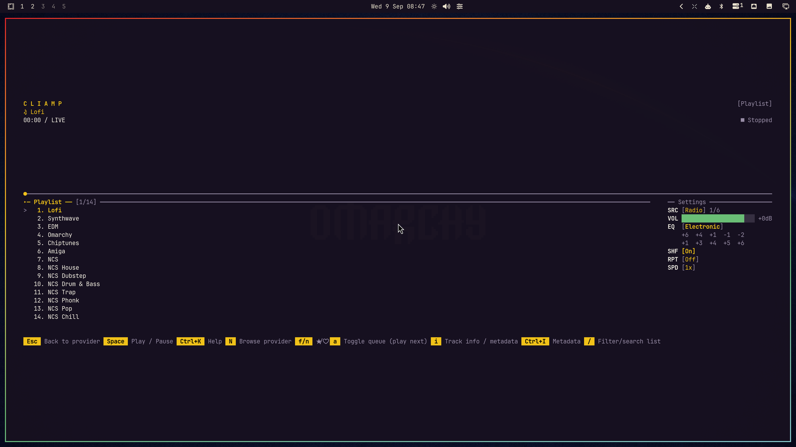

# 🤖 Omarchy Raiders

An [Omarchy](https://omarchy.org) theme, a tribute to the retro poster art of
ARC Raiders: plum-black space, bone-cream type, and a rainbow stripe cutting
across it. Dark first, readable always.


## ✨ What you get

- **Palette** sampled from an ARC Raiders poster — a plum-black ground that
  reads as black but leans purple, the bone cream of the logo lettering for
  text, a gold accent, and the poster's rainbow stripe supplying the terminal
  hues. Every colour clears its contrast target on every background — body
  text sits near 14.4:1, and `muted`, the grey used for code comments, holds
  at 6.1:1 instead of the usual 3-ish.
- **Everything themed at once**: terminals (foot, Alacritty, Kitty, Ghostty),
  Neovim, btop, Helix, the Omarchy bar, launcher, notifications, lock screen,
  Chromium, VS Code, Obsidian, Claude Code, and the keyboard backlight.
- **Window borders** carry the whole stripe — red into gold into green into
  aqua — around the focused window.
- **Seven 4K wallpapers**: a rainbow arc over deep navy and a low horizon
  under the stripe, each with and without the Omarchy wordmark, plus a
  listening field, a planetary sunrise, and a remote observatory at dusk.
- **Optional extras**: an original radio telescope beneath a crescent moon
  greeting you in every new terminal, a wider listening-station landscape on
  the About screen, and a matching theme for the cliamp music player.

## 📦 Install

```bash
omarchy theme install https://github.com/itsMattGuenther/omarchy-omarchy-raiders-theme.git
```

The theme is applied right away. Later, switch with:

```bash
omarchy theme set omarchy-raiders
omarchy theme bg next        # cycle wallpapers
```

## 🎨 Wallpapers


Seven variants live in `backgrounds/`, all 3840x2160. They sort by filename, so
the numbered prefixes decide the order `omarchy theme bg next` walks. Add your
own next to them, or drop extra images into
`~/.config/omarchy/backgrounds/omarchy-raiders/` to keep them out of the theme folder.

The three new scenes form **The Listening Station** collection:

| File | Scene |
| --- | --- |
| `05_raiders_listening_field.jpg` | A lone radio telescope beneath dusty violet starlight |
| `06_raiders_penumbra.jpg` | A dark planetary limb catching gold and cyan sunlight |
| `07_raiders_afterlight.jpg` | A distant observatory above a warm, fading horizon |

These three were made with built-in AI image generation and exported to 4K
using Lanczos upscaling from 1672x941 originals. They are 4K files, not native
4K generations. The four poster-style wallpapers are unchanged. See
[artwork provenance](docs/artwork.md) and the
[complete generation prompts](docs/wallpaper-prompts.json).

## 🖼️ The art



**Still listening** replaces the figure with a delicate parabolic dish, a
cream crescent and a broken spectral orbit. Its companion, **The listening
station**, adds a distant observatory and layered terrain. Both are original
vector drawings converted to Braille, without tracing a photograph or game
asset. A Braille character is two dots by four; the shapes are drawn for that
grid instead of shrinking a detailed illustration into noise.

Rendered terminal greeting (56 columns by 18 rows):



Rendered About layout (64 columns by 24 rows of art). The installed About file
is plain text so Omarchy can measure its width correctly; it inherits
fastfetch's logo colour. The greeting uses the full theme palette:



Both live in `extras/art/` as plain text and ANSI colour versions, with their
SVG sources and the converter alongside. Rendering tools are needed only
when editing the art, never when opening a terminal.

## 🎵 cliamp



A matching theme for the [cliamp](https://github.com/omacom-io/cliamp) music
player. The theme hook switches cliamp to it while Omarchy Raiders is active and puts
your previous cliamp theme back when you switch away.

## 🔐 The lock screen

The lock screen (Super+Escape) shows a blurred copy of whichever wallpaper you
are on, with the theme's colours on the password box. That is how Omarchy
builds it, and no theme can put its own artwork there.

## 👾 Extras (optional)

Omarchy cannot install the art, the greeting or the cliamp theme from a theme
repo, so there is a one-shot script:

```bash
~/.config/omarchy/themes/omarchy-raiders/extras/install.sh
```

What it changes:

- copies files into `~/.config/omarchy-raiders/` and `~/.config/cliamp/themes/`
- adds one marked block at the end of `~/.bashrc` (a backup is kept as
  `.bashrc.bak.omarchy-raiders`)
- installs a theme hook, `omarchy-raiders-theme-set.sh`, that switches cliamp and the
  About logo whenever this theme is active, and puts both back when you pick
  another theme

The hook is named after the theme rather than `theme-set.sh`, so it sits
alongside other themes' hooks instead of overwriting them.

The greeting and the About art only show while this theme is the active one,
so other themes are left alone.

To remove all of it:

```bash
~/.config/omarchy/themes/omarchy-raiders/extras/install.sh --uninstall
```

## 🛠️ Hacking on it

- `colors.toml` is the whole palette. Everything else is generated from it.
- The Braille art is generated from `extras/art/*.svg`. Edit the vectors, then
  run `python3 extras/art/render.py` (Python 3.11+, librsvg, ImageMagick).
  See [the extras guide](extras/README.md) for dimensions and preview commands.

## 🙏 Credits

- Colours sampled from an ARC Raiders promotional poster. This is an
  unofficial tribute and is not affiliated with, endorsed by, or associated
  with Embark Studios or Nexon; ARC Raiders is their trademark. No artwork
  from the game is included here — the wallpapers and the Braille art are
  original.
- Built on Omarchy's theme system by DHH and the Omarchy community.

## 🤝 Contributing

I'd gladly take help from anyone who wants to iterate on this: better art,
palette tweaks, new extras, anything. Open an issue or a pull request. I'm here
for the community <3

## ⚖️ License

MIT, see `LICENSE`.
