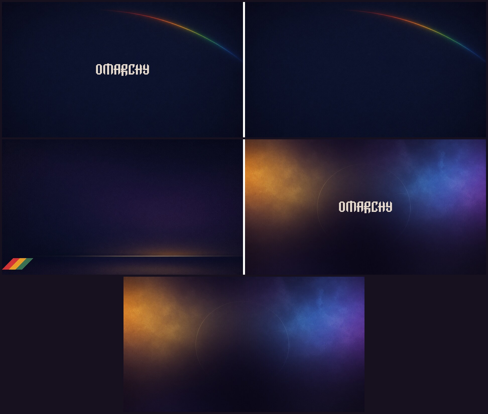

# 🤖 Omarchy Raiders

An [Omarchy](https://omarchy.org) theme, a tribute to the retro poster art of
ARC Raiders: plum-black space, bone-cream type, and a rainbow stripe cutting
across it. Dark first, readable always.


## ✨ What you get

- **Palette** sampled from an ARC Raiders poster — a plum-black ground that
  reads as black but leans purple, the bone cream of the logo lettering for
  text, a gold accent, and the poster's rainbow stripe supplying the terminal
  hues. Every color clears its contrast target on every background — body
  text sits near 14.4:1, and `muted`, the grey used for code comments, holds
  at 6.1:1 instead of the usual 3-ish.
- **Everything themed at once**: terminals (foot, Alacritty, Kitty, Ghostty),
  Neovim, btop, Helix, the Omarchy bar, launcher, notifications, lock screen,
  Chromium, VS Code, Obsidian, Claude Code, and the keyboard backlight.
- **Window borders** carry the whole stripe — red into gold into green into
  aqua — around the focused window.
- **Seven 4K wallpapers**: a rainbow arc over deep navy and a low horizon
  under the stripe, each with and without the Omarchy wordmark, plus a
  listening field, a planetary sunrise, and a remote observatory at dusk.
- **Optional extras**, in [their own repo](https://github.com/itsMattGuenther/omarchy-theme-extras/tree/main/omarchy-raiders):
  an original radio telescope beneath a crescent moon greeting you in every new
  terminal, a wider listening-station landscape on the About screen, and a
  matching theme for the cliamp music player.

## 📦 Install

```bash
omarchy theme install https://github.com/itsMattGuenther/omarchy-omarchy-raiders-theme.git
```

The theme is applied right away. Later, switch with:

```bash
omarchy theme set omarchy-raiders
omarchy theme bg next        # cycle wallpapers
```

## 🎨 Wallpapers



Seven variants live in `backgrounds/`, all 3840x2160. They sort by filename, so
the numbered prefixes decide the order `omarchy theme bg next` walks. Add your
own next to them, or drop extra images into
`~/.config/omarchy/backgrounds/omarchy-raiders/` to keep them out of the theme folder.

## 👾 Extras (optional)


**Still listening**, a radio telescope beneath a crescent moon, greets you in
every new terminal; **The listening station**, a wider landscape, takes over
the About screen; and a matching theme dresses the cliamp music player. A
theme can't ship the script that puts these in place, so they live in
[omarchy-theme-extras](https://github.com/itsMattGuenther/omarchy-theme-extras/tree/main/omarchy-raiders), with install and
uninstall steps.

## 🛠️ Hacking on it

- `colors.toml` is the whole palette. Everything else is generated from it.

## 🙏 Credits

- Colors sampled from an ARC Raiders promotional poster. This is an
  unofficial tribute and is not affiliated with, endorsed by, or associated
  with Embark Studios or Nexon; ARC Raiders is their trademark. No artwork
  from the game is included here — the wallpapers and the Braille art are
  original.
- Built on Omarchy's theme system by DHH and the Omarchy community.

## 🤝 Contributing

I'd gladly take help from anyone who wants to iterate on this: better art,
palette tweaks, new extras, anything. Open an issue or a pull request. I'm here
for the community <3

## ⚖️ License

MIT, see `LICENSE`.
